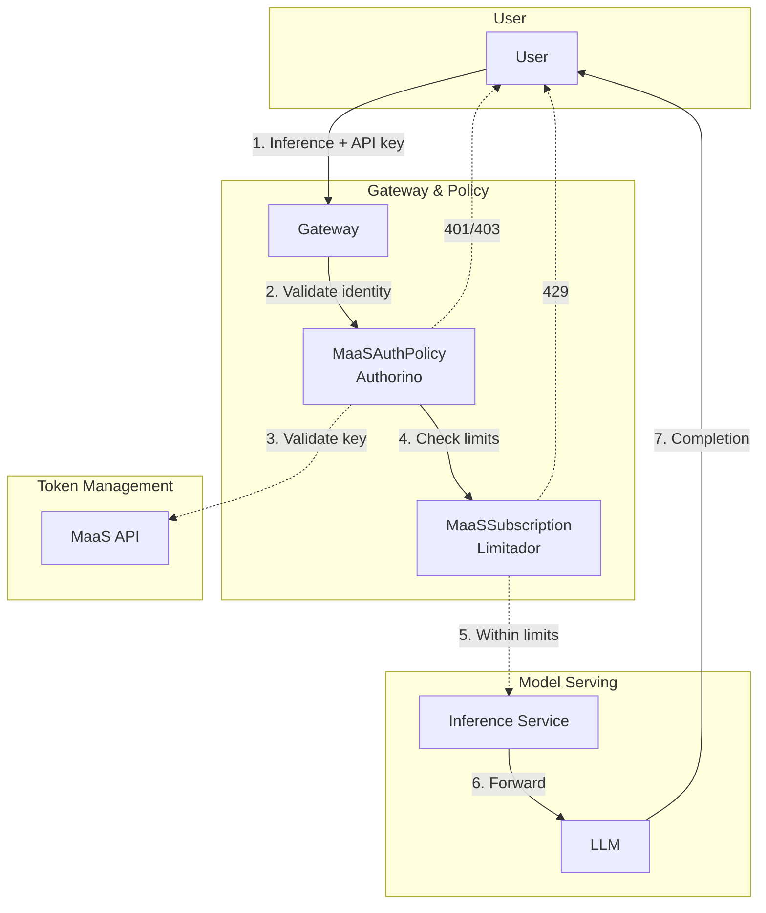
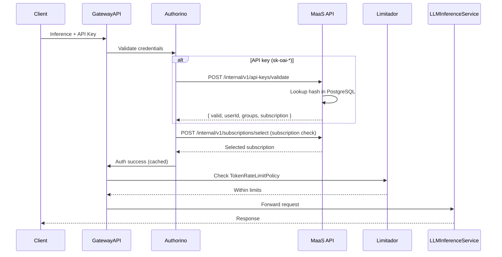

This page explains how Red Hat OpenShift AI Models as a Service works under the hood — what each component does and how a request travels from a user's laptop to a model and back.

> [!TIP]
> All file paths and `oc apply` commands in this guide are relative to the [CAI-Field-Manual-MaaS](https://github.com/rh-aiservices-bu/CAI-Field-Manual-MaaS) repository root. Make sure you have cloned it and are working from its root directory (see [Getting Started]()).

> [!IMPORTANT]
> This guide is not a replacement for the official Red Hat OpenShift AI Models as a Service documentation ([3.5](https://docs.redhat.com/en/documentation/red_hat_openshift_ai_self-managed/3.5/html/govern_llm_access_with_models-as-a-service/index) | [3.4](https://docs.redhat.com/en/documentation/red_hat_openshift_ai_self-managed/3.4/html/govern_llm_access_with_models-as-a-service/index)). It is a companion resource with opinionated Kustomize manifests and automation scripts to accelerate deployment.

## Component Overview

Models as a Service is built from four layers, each with a distinct responsibility:

| Layer | Components | Role |
| --- | --- | --- |
| **Gateway** | Gateway API, Istio | Entry point for all traffic. HTTPRoutes direct requests to the right model endpoint. |
| **Policy** | Kuadrant, Authorino, Limitador | Enforce authentication, authorization, and rate limiting at the edge — before requests reach any model. |
| **API & Token** | maas-api, PostgreSQL | API key lifecycle: mint, validate, and revoke `sk-oai-*` keys. Stores hashed keys and subscription bindings. |
| **Model Serving** | KServe (LLMInferenceService), vLLM, ExternalModel | Run inference. Internal models run as vLLM pods on-cluster; external models proxy to third-party APIs (Anthropic, OpenAI, etc.). |

## Request Flow: Step by Step

Here is what happens when a user makes an inference request, from their laptop to the model and back.



*Diagram source: [Upstream MaaS Architecture](https://opendatahub-io.github.io/models-as-a-service/latest/concepts/architecture/)*

### 1. Create an API Key

The user authenticates with their OpenShift token (or an external IdP token) and requests an API key:

```sh
curl -X POST https://maas.${CLUSTER_DOMAIN}/maas-api/v1/api-keys \
  -H "Authorization: Bearer <identity-token>" \
  -d '{"subscription": "my-subscription", "expiresIn": "24h"}'
```

Authorino validates the identity token. If valid, maas-api generates a random `sk-oai-*` key, hashes it with SHA-256, stores the hash and subscription binding in PostgreSQL, and returns the plaintext key **once**.

> [!NOTE]
> The `subscription` field is optional. If you omit it, maas-api binds the highest-priority subscription your groups have access to. The field name is `subscription` (not `subscriptionName`).

### 2. Send an Inference Request

The user sends a chat completion request using the API key:

```sh
curl https://maas.${CLUSTER_DOMAIN}/v1/chat/completions \
  -H "Authorization: Bearer sk-oai-..." \
  -H "Content-Type: application/json" \
  -d '{"model": "my-model", "messages": [{"role": "user", "content": "Hello"}]}'
```

### 3. Gateway Receives the Request

The request hits the `maas-default-gateway` in the `openshift-ingress` namespace. The Gateway API controller (backed by Istio) matches the request against HTTPRoutes to determine which backend to forward to.

### 4. Authorino Validates the API Key

Before the request reaches any model, Authorino intercepts it (via `MaaSAuthPolicy`) and calls the maas-api `/internal/v1/api-keys/validate` endpoint:

* Looks up the salted hash in PostgreSQL
* Returns the user identity (username, groups, key ID) and the subscription name bound to that key
* Rejects unknown, revoked, expired, or malformed keys with `401 Unauthorized`

### 5. Subscription Access Check

Using the subscription name from the key record (not from client headers), Authorino checks:

* Is the user/group allowed to use this subscription?
* Is the requested model included in the subscription?

If either check fails, the request is rejected with `403 Forbidden`.

### 6. Rate Limiting

Limitador checks the request against the rate limits defined in the `MaaSSubscription` CR:

* Requests per minute/hour
* Token budgets per time window

If the user has exceeded their limits, the request is rejected with `429 Too Many Requests`.

### 7. Forward to Model

If all checks pass, the request is forwarded to the model backend:

* **Internal model** (InferenceService): routed to a vLLM pod running on-cluster via KServe
* **External model** (ExternalModel): proxied to a third-party API (e.g., Anthropic Claude, OpenAI GPT)

The model processes the request and returns a completion response.

### 8. Response Returns to User

The response flows back through the Gateway to the user. Limitador updates usage counters (tokens consumed, requests made) for the subscription.

### Sequence Diagram

The full inference flow as a sequence diagram, showing every component interaction:



## Interactive Flow Visualizer

To see all of the above in action, explore the interactive animated visualizer — it walks through 5 complete flows (including auth failures and rate limiting) step by step with clickable components and a request/response inspector.

For pod-by-pod debugging with `oc` commands, see [Request Deep Dive]().

> [!NOTE]
>  (opens in a new tab)
> *5 Flows | 5 Providers | Two-stage IPP | 33 Steps | 30+ Components*
> Corrected two-stage IPP (pre/post Kuadrant), WasmPlugin CRs, ExternalProvider/ExternalModel split, ipp-managed label, redhat-ai-gateway-infra namespace.

## References

* [Upstream MaaS Architecture](https://opendatahub-io.github.io/models-as-a-service/latest/concepts/architecture/)
* 
*  - animated walkthrough of the phase sequence, the most common ordering mistake, governance pairing, and tiers/priority
* [RHOAI 3.5 MaaS Official Docs](https://docs.redhat.com/en/documentation/red_hat_openshift_ai_self-managed/3.5/html/govern_llm_access_with_models-as-a-service/index)
